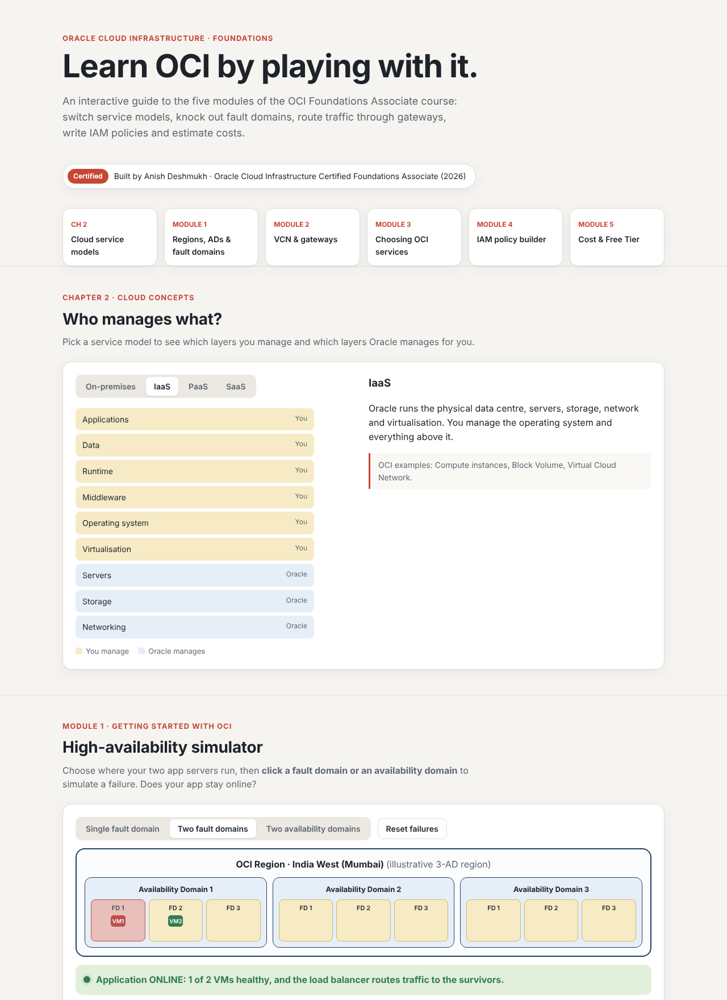

# OCI Foundations Explorer

An interactive, single-page website that teaches the core concepts of **Oracle Cloud Infrastructure (OCI)** through hands-on simulations, covering every module of the *OCI Foundations Associate* course.

Built by **Anish Deshmukh** (B.Tech CSE, Manipal University Jaipur, 23FE10CSE00779) as the demonstration project for the Value-Added Course **Oracle Cloud Infrastructure Foundations Associate**.
Credential: *Oracle Cloud Infrastructure Certified Foundations Associate*, 28 July 2026 (ID 103569336OCI26FNDCFA).

**Live demo:** `https://anishcoree.github.io/oci-foundations-explorer/`



## Features and course mapping

| Section | What you can do | Course module / report chapter |
|---|---|---|
| **Who manages what?** | Switch between On-premises, IaaS, PaaS and SaaS and see which layers you manage and which Oracle manages | Cloud concepts (Ch 2) |
| **High-availability simulator** | Place two VMs in one fault domain, two fault domains or two availability domains, click to fail an FD or AD, and see whether the app stays online | Module 1 – Regions, ADs, fault domains (Ch 3) |
| **Which gateway carries the traffic?** | Pick a scenario and watch the traffic path through an Internet, NAT or Service Gateway, or a DRG, in a VCN with public and private subnets | Module 2 – Networking (Ch 4) |
| **Service matcher** | Match 8 real requirements to the right service (Object Storage, Functions, Autonomous DB, Generative AI, Monitoring, Vault, Cloud Guard, Resource Manager) | Modules 2–4 (Ch 4–6) |
| **IAM policy builder** | Build `Allow group … to <verb> <resource> in <compartment>` statements, see the permissions each verb grants, and get least-privilege warnings | Module 4 – Security & identity (Ch 6) |
| **Monthly cost estimator** | Estimate cost with the Always Free allowances applied, and see a budget alert fire when spend crosses 100% | Module 5 – Billing & governance (Ch 7) |
| **Foundations quiz** | 10 exam-style questions with instant feedback and a score | All modules |

> The cost estimator uses **illustrative rates for teaching only**. For real prices, use Oracle's official Cost Estimator.

## Tech stack

- Plain **HTML, CSS and JavaScript**: no frameworks, no build step, no backend
- Interactive diagrams drawn with inline **SVG**
- Responsive layout that works on phones
- Hosted free on **GitHub Pages**

## Run locally

```bash
git clone https://github.com/anishcoree/oci-foundations-explorer.git
cd oci-foundations-explorer
# open index.html in a browser, or serve it:
python3 -m http.server 8000   # then visit http://localhost:8000
```

## Deploy on GitHub Pages

1. Push this folder to a public GitHub repository named `oci-foundations-explorer`.
2. Go to **Settings → Pages**.
3. Under **Build and deployment**, choose **Deploy from a branch**, select `main` and `/ (root)`, then click **Save**.
4. After about a minute the site is live at `https://anishcoree.github.io/oci-foundations-explorer/`.

## Project structure

```
oci-foundations-explorer/
├── index.html        # the whole app (markup, styles, scripts)
├── README.md
└── screenshots/      # images used in this README and the training report
```

## Disclaimer

This is an educational project and is not affiliated with or endorsed by Oracle. Concepts are based on the Oracle University course and the public OCI documentation.
